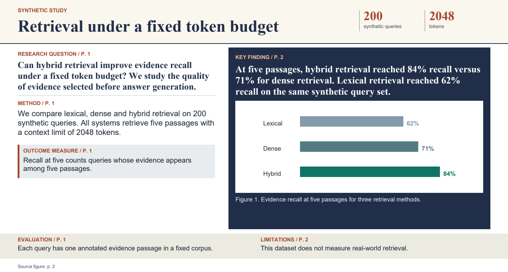

# PaperCanvas

Group 56 · HKU COMP7608B  
**Joint Semantic and Spatial Reasoning for Scientific Poster Generation**  
Baodi Han, Shitu Ma, Yifan Sui, Jinkai Tao

PaperCanvas helps a researcher turn a text-based paper PDF into an editable, single-slide PowerPoint poster and revise it in conversation. This demo focuses on three claims (question, method, finding) with a primary figure or table and, when the source and canvas support it, a second cited figure. It records the source passage, page, required conditions, review observations and resulting layout.



[Editable demo poster](examples/poster.pptx) · [Synthetic input paper](examples/retrieval_study.pdf) · [Observed demo results](evaluation/offline-results.json)

## Run the demo

Use Python 3.12. From the repository root, install into a virtual environment and start the local app:

```sh
python -m venv .venv
# Windows PowerShell: .\.venv\Scripts\Activate.ps1
# macOS/Linux: source .venv/bin/activate
python -m pip install -r requirements.txt
python papercanvas.py demo
```

Open **http://127.0.0.1:8765**. The Chinese-language studio starts with a generated poster from a two-page synthetic retrieval study. No API key is needed for local mode.

1. Open **论文证据**. Select a claim to read its source passage, or select the figure to see the exact crop on the source page.
2. Open **策略对照** and click **运行对照**. Both branches attempt the same 35% enlargement while preserving the result text. Each starts from your accepted poster. Inspect the final candidates, measured figure widths and issues from each attempt. The accepted session stays intact.
3. Under **海报编辑**, apply the enlargement. Try locking a paragraph and then shortening that paragraph to two words. **修订记录** lets you inspect the initial draft, each editing pass, rejected candidates and the retained version. Refreshing the same tab restores its session.
4. **导入论文** accepts an English text-based PDF (up to 16 MB). Set the page dimensions or select either synthetic example. Download the accepted poster with **↓ PPTX**.

### A published paper

Run `python examples/fetch_open_paper.py` once to cache the original open-access PDF locally. Refresh the studio, select **导入论文 → 开放论文 · Hadi 等**, and generate. This uses the same extractive planner as uploaded PDFs. The source is Hadi, Tran, Nagarajan and Kirpalani (2024), [Evaluation of ChatGPT as a diagnostic tool for medical learners and clinicians](https://doi.org/10.1371/journal.pone.0307383), PLOS ONE, CC BY. The publisher download is hash-checked. Generated posters credit the authors and identify the adaptation. This input is for testing document handling.

### Local extraction and its limits

The field-observation example uses a recorded semantic plan. Other local PDFs use section headings and sentence cues to select source text. The parser looks for a column gutter, matches explicit figure references, and locates image/vector marks above captions. Required source phrases survive editing. The local layout pass measures alternative column and figure allocations and chooses the smallest change that resolves the observed geometry problems. The local reviewer checks measurable geometry and text invariants. It does not independently judge scientific correctness. Inspect the evidence tab for misselected claims, reading-order errors or incorrect crops, especially on multi-column pages. Scans, complex tables and figures without detectable visual marks may require a different input or vision provider.

## Use a vision-language model

Configure a vision-capable Chat Completions model that supports image input, JSON object output, temperature and max_tokens. Model access may incur provider charges. In PowerShell, set the following variables in the terminal that launches the app:

```powershell
$env:PAPERCANVAS_MODEL = 'your-vision-model-id'
$env:OPENAI_API_KEY = [System.Net.NetworkCredential]::new('', (Read-Host -AsSecureString 'API key')).Password
python papercanvas.py demo --live
```

The live app accepts a PDF upload and natural-language requests to enlarge a figure, shorten a section or protect text. One title, three text panels and one evidence crop are supported. It requests clarification for other actions. The optional OPENAI_BASE_URL must be a trusted HTTPS API base ending in /v1. The service receives paper text, selected page images, poster previews and edit instructions. The key is read from the environment, sent in the Authorization header and excluded from state, trace and exports. Supply provider rates in PAPERCANVAS_INPUT_USD_PER_M and PAPERCANVAS_OUTPUT_USD_PER_M to estimate cost per million tokens. Unconfigured rates appear as null. Offline cost is zero.

The live API path requires your service credentials. It has not been validated against a paid provider in this release. Scanned PDFs without text, unverifiable quotes, missing figures, invalid model output and unresolved checks can cause a recorded failure. Font metrics use the Latin Helvetica/Arial family. Validate other scripts and complex typography before using them.

## CLI and artifacts

```sh
python papercanvas.py generate examples/paired_review.pdf --size 1008 540 --out runs/talk
python papercanvas.py edit runs/talk "enlarge figure by 35% and protect result"
python papercanvas.py edit runs/talk "shorten question to 6 words"
python papercanvas.py generate your-paper.pdf --live --out runs/paper
python papercanvas.py edit runs/paper "shorten the method to 20 words" --live
python verify_demo.py
python evaluate.py run --out runs/offline-evaluation
```

Use a fresh output directory for each generation. Sessions keep initial.json, evidence.png, trace.jsonl and versioned PPTX/PNG/review files. state.json points to the accepted version. Failed edits keep that pointer and append the reason to history. Browser runs are stored under runs/web. Each process serves one local user. An interrupted editor can leave a .editing lock; after verifying that the process stopped, remove that lock to resume. The app does not require a notebook or PowerPoint installation.

## Poster composition

The one-slide PPTX includes individually editable text boxes and figure crops. The masthead uses quantities verified in the method passage. The findings panel pairs the main claim with its cited figure. When the paper provides them, the poster includes outcome definitions, evaluation details and limitations with page references. On canvases at least 640 pt tall, the extractive planner can add a second result that explicitly cites another detected figure. The evidence index links these additions to the paper.

## Implementation and checks

- **Source and content** — paper_canvas/source.py extracts per-page text, tables and captions. The live planner chooses claims and a supporting caption, then localizes the figure/table on its source-page image. Source page/quote matching and required-phrase checks reject unverifiable inputs.
- **Joint revisions** — paper_canvas/agent.py alternates two content passes and two layout passes. The live reviewer sees the rendered poster and the source evidence after every pass. The editor can shorten prose, change column widths and assign more height to evidence. Required scientific conditions remain fixed. The protected-text guard compares exact strings.
- **Rendering** — paper_canvas/render.py measures lines, preserves figure aspect ratio, and detects overflow, overlaps and out-of-canvas elements. PPTX text blocks and pictures are independently editable. The PNG is rendered from the same measured scene via PDFium. PowerPoint can substitute fonts and produce slightly different glyph positions.
- **Dialogue** — a request uses the preceding accepted version, prior size/word constraints and edit history. Each request has at most two attempts. A fixed-layout baseline can resize the requested figure but cannot move the other boxes. The model prompts and API settings are in paper_canvas/model.py.
- **Evidence** — see evaluation/offline-dialogue.jsonl for the two-attempt recovery and protected-text rejection. verify_demo.py also covers malformed input, an ambiguous request and rollback. The synthetic example can be regenerated with python examples/make_paper.py.

## Proposal evaluation protocol

1. Obtain the Paper2Poster 100 paper–poster pairs and keep the 100 source PDFs in a separate directory. Reference posters are for human context only. Use `python evaluate.py split path/to/papers plan.json --seed 56`. This selects 5 development and 15 evaluation papers, and preselects 5 dialogue cases.
2. On development data, set standard canvas dimensions and readability thresholds. Review the three-turn scripts and their feasibility labels for the five selected papers before freezing plan.json, prompts, model ID and settings. The bundled script is calibrated only for the synthetic paper. Prepare an independent per-paper claim/context checklist before viewing outputs. Keep it outside model inputs.
3. With credentials configured, run `python evaluate.py run --papers path/to/papers --plan plan.json --out runs/study`. This can issue hundreds of paid requests. It compares content-first, layout-first and joint from the same extracted draft and evidence at each size. Each schedule receives two content and two layout passes, the same reviewer schedule and per-call completion cap. Both dimensions scale by √0.75 for the smaller canvas; typography stays fixed. Dialogue conditions fork the same accepted poster. Inspect actual token usage, runtime, failures and estimated cost in traces. The runner preserves the denominator when parsing or generation fails.
4. Give each of two independent evaluators the source papers, frozen checklists, anonymized previews and their randomized rater CSV. Keep the blinding key private until both have scored. Record checklist coverage, wrong numerical claims, mismatched evidence, geometric errors, figure-label legibility and reading order (1 = major difficulty, 3 = edits needed, 5 = clear). Also check dialogue completion, reference resolution, protected text and new errors. Report paired differences by paper/size, agreement, denominators, feasible-request completion and conflict detection separately.

The checked-in evaluation is a synthetic smoke run across 2 sizes × 3 strategies. The 15-paper study, human ratings and agreement measurements are outstanding. No comparative scientific claim follows from the fixture.

## Attribution and AI assistance

The two bundled sample papers and their charts are synthetic and bundled for redistributable testing. Runtime dependencies and versions are listed in requirements.txt. The planned dataset and comparator protocol come from the Group 56 proposal and [Paper2Poster](https://github.com/Paper2Poster/Paper2Poster). Codex generated the demo code, sample, prompts, checks and documentation from the project proposal and the request to build and publish a demo. Runtime agent prompts are in paper_canvas/model.py. This demo is not a final course submission or a record of individual student contributions.
